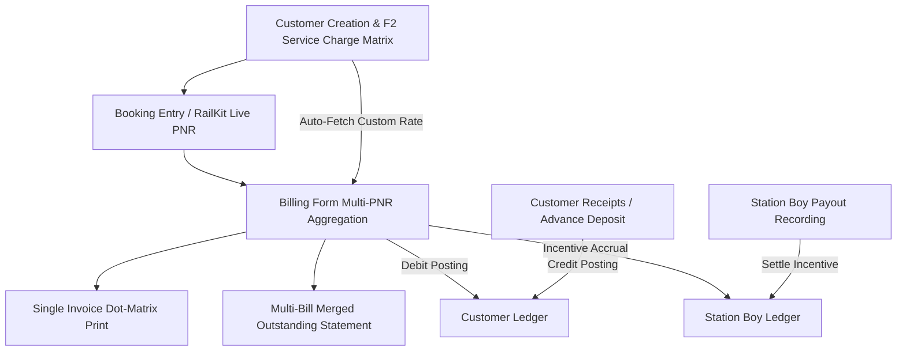

# YATRASATHI ERP — COMPLETE SYSTEM MEMORY & ENCYCLOPEDIC CODEBASE REFERENCE

> **System Name:** YatraSathi Travel Management ERP  
> **Platform Stack:** Node.js / Express Backend + MySQL (Sequelize ORM) + React (Vite) Frontend + PDFKit / Dot-Matrix Printing Engine + RailKit Live Indian Railways API.  
> **Architecture Pattern:** Multi-Database / Multi-Tenant (Master Database: `YATRASATHI_MASTER`, Year Databases: `TVL_YYYY_YY` e.g., `TVL_2024_25`, `TVL_2025_26`, `TVL_2026_27`).  
> **Port Configuration:** Backend Express Server on `http://localhost:5004`, Frontend React/Vite App on `http://localhost:3001` (or fallback `http://localhost:5173`).

---

## 1. System Architecture & Database Schema

### 1.1 Dual Database Paradigm
- **Master Database (`YATRASATHI_MASTER`)**:
  - Stores global configurations, system users (`usXuser`), security permissions (`opXoper`, `moXmodl`, `apXappl`), customer defaults, financial years mapping, and audit logs.
  - Connection Pool: `sequelize` defined in `config/db.js`.
- **Year-Specific Transactional Database (`TVL_2024_25`, `TVL_2025_26`, `TVL_2026_27`)**:
  - Stores financial period specific data: Bookings, Passengers, Bills, Customer Service Charges, Payments, Receipts, Contras, Journals, Station Boy transactions.
  - Connection Pool: `sequelizeTVL` defined in `config/db.js` with dynamic schema switching based on user session or `X-Financial-Year` header.

### 1.2 Comprehensive Table & Model Catalog (`src/models/`)

#### 1. User & Authentication Models
- **`UserTVL` (`usXuser`)**:
  - Columns: `us_usid` (VARCHAR(15) PK, e.g. `'ADM001'`, `'CUS00001'`), `us_fname` (VARCHAR(100)), `us_lname` (VARCHAR(100)), `us_email` (VARCHAR(120)), `us_phone` (VARCHAR(30)), `us_pwd` (VARCHAR(255) bcrypt hash), `us_roid` (`'ADM'`, `'CUS'`, `'EMP'`), `us_usertype` (`'admin'`, `'customer'`, `'employee'`), `us_limit` (DECIMAL(18,2) - Authorization/Credit limit), `us_addr1` (VARCHAR(255)), `us_city` (VARCHAR(100)), `us_active` (TINYINT 1/0), `us_eby`, `us_edtm`, `us_mby`, `us_mdtm`.
- **`LoginTVL` (`lgXlogi`)**:
  - User session tokens, login/logout timestamps, client IP, and browser user agent.
- **`RoleTVL` (`roXrole`) & `RolePermissionTVL` (`rpXrolp`)**:
  - Role-Based Access Control (RBAC) linking roles (`ro_roid`) to operation permissions (`op_opid`).
- **`ApplicationTVL` (`apXappl`) & `ModuleTVL` (`moXmodl`) & `PermissionTVL` (`opXoper`)**:
  - Hierarchical security tree: Application $\rightarrow$ Module $\rightarrow$ Operations.

#### 2. Unified Customer Model (`cuXcustomer`)
- **`CustomerTVL` (`cuXcustomer`)**:
  - **Unified Master Table**: Consolidates both identity/contact attributes and financial settings into a single table.
  - **Uniqueness Guarantee**: Enforces database-level uniqueness constraints on customer name (`uq_cu_name` on `cu_name`, `uq_customer_fullname` on `(us_fname, us_lname)`), preventing duplicate customer name insertions.
  - **Columns**:
    - Identity & Contact: `us_fname` (First Name), `us_lname` (Last Name), `cu_name` (Customer Name - Unique), `us_email` (Email), `us_phone` (Phone No), `us_pwd` (Password Hash), `us_addr1` (Address), `us_city` (City), `us_state` (State), `us_pin` (Pincode), `us_aadhaar` (Aadhaar), `us_title` (Title).
    - Customer Account & Financials: `cu_cusid` (PK), `cu_usid` (Account User ID), `cu_custno` (Account Number), `cu_custtype` (`'INDIVIDUAL'` / `'CORPORATE'`), `cu_compid` (Company ID), `cu_creditlimit` (Credit Limit), `cu_creditdays`, `cu_discount`, `cu_panno` (PAN), `cu_gstno` (GSTIN), `cu_active` (1/0), `status` (`'OPEN'`, `'CLOSED'`, `'CANCELLED'`), `cu_servicecharge_config` (JSON rate matrix), `entered_by`, `entered_on`, `modified_by`, `modified_on`.
  - **Direct Single-Table Access**: Queries for customer search, phone lookups on the booking form, and customer listings read and write directly to `cuXcustomer`.
  - **Employee Customer Search API**: Route `/api/employee/customers` mounted before `/api/employee` in `server.js` to ensure employee customer lookups (`/search?q=...`, `/phone/:phoneNumber`) are resolved without routing collisions.
- **`CustomerServiceCharge` (`customer_service_charges`)**:
  - Columns: `id` (INT Auto PK), `customerId` (VARCHAR(15) FK), `serviceType` (`'RESERVATION'`, `'CANCELLATION'`), `chargeType` (`'FLAT'`, `'PERCENTAGE'`), `classType` (`'1AC'`, `'2AC'`, `'3AC'`, `'EC'`, `'CC'`, `'FC'`, `'SL'`, `'2S'`), `pax1` to `pax6` (DECIMAL(10,2) charges for 1 to 6 passengers), `remarks` (VARCHAR(255)), `deliveryCharge` (DECIMAL(10,2)), `entered_by` (INT), `modified_by` (INT).
- **`ServiceChargeDefault` (`service_charge_defaults`)**:
  - System-wide fallback matrix applied when a customer does not have a customized rate sheet.

#### 3. Booking & Passenger Models
- **`Booking` / `BookingTVL` (`bkXbook`)**:
  - Columns: `bk_bkid` (INT PK), `bk_bkno` (VARCHAR(50) Unique), `bk_usid` (VARCHAR(15) Customer ID), `bk_fromst` (VARCHAR(10) Origin), `bk_tost` (VARCHAR(10) Destination), `bk_trvldt` (DATETIME Journey Date), `bk_class` (VARCHAR(10) Class), `bk_pnr` (VARCHAR(10) Indian Railways PNR), `bk_fare` (DECIMAL(10,2)), `bk_status` (`'CONFIRMED'`, `'WAITLIST'`, `'CANCELLED'`, `'BILLED'`), `bk_agent` (VARCHAR(100)), `bk_station_boy_id` (INT), `bk_station_boy_incentive` (DECIMAL(10,2)), `bk_advance` (DECIMAL(10,2)).
- **`Passenger` / `PassengerTVL` (`psXpass`)**:
  - Columns: `ps_psid` (INT PK), `ps_bkid` (INT FK to `bkXbook`), `ps_fname` (VARCHAR(100)), `ps_lname` (VARCHAR(100)), `ps_age` (INT), `ps_gender` (`'M'`, `'F'`, `'O'`), `ps_berthpref` (Berth preference), `ps_berthallot` (Allocated berth), `ps_seatno` (Seat number), `ps_coach` (Coach number), `ps_status` (`'CNF'`, `'WL'`, `'RAC'`), `ps_idtype`, `ps_idno`.
- **`MasterPassengerTVL` (`master_passengers`)**:
  - Saved frequent traveler profiles reusable across bookings.

#### 4. Billing Models
- **`BillTVL` (`blXbill`)**:
  - Columns: `bl_id` / `bl_billid` (INT PK), `bl_billno` (VARCHAR(50) Unique), `bl_bkid` (INT FK to `bkXbook`), `bl_customer_id` (VARCHAR(15)), `bl_customer_name` (VARCHAR(150)), `bl_customer_phone` (VARCHAR(30)), `bl_pnr` (VARCHAR(255) comma-separated PNRs), `bl_train_no` (VARCHAR(50)), `bl_class` (VARCHAR(20)), `bl_from_station` (VARCHAR(20)), `bl_to_station` (VARCHAR(20)), `bl_journey_date` (DATETIME), `bl_railway_fare` (DECIMAL(10,2)), `bl_service_charges` (DECIMAL(10,2)), `bl_station_boy_id` (INT), `bl_station_boy_incentive` (DECIMAL(10,2)), `bl_misc_charges` (DECIMAL(10,2)), `bl_delivery_charges` (DECIMAL(10,2)), `bl_gst_type` (`'EXCLUSIVE'`, `'INCLUSIVE'`, `'C'`), `bl_gst` (DECIMAL(10,2)), `bl_surcharge` (DECIMAL(10,2)), `bl_total_amount` (DECIMAL(10,2)), `bl_advance_amount` (DECIMAL(10,2)), `bl_status` (`'ACTIVE'`, `'CANCELLED'`, `'SPLIT'`, `'RECONCILED'`), `bl_special_id` (VARCHAR(50)), `bl_sub_bill_no` (VARCHAR(50)).

#### 5. Station Boy Models
- **`StationBoy` (`station_boys`)**:
  - Columns: `id` (INT PK), `name` (VARCHAR(100)), `phone` (VARCHAR(20)), `address` (TEXT), `status` (`'ACTIVE'`, `'INACTIVE'`), `totalIncentive` (DECIMAL(12,2)), `totalPaid` (DECIMAL(12,2)), `pendingPayable` (DECIMAL(12,2)).
- **`StationBoyPayment` (`station_boy_payments`)**:
  - Columns: `id` (INT PK), `stationBoyId` (INT FK to `station_boys`), `amount` (DECIMAL(10,2)), `paymentDate` (DATE), `paymentMode` (`'CASH'`, `'UPI'`, `'BANK_TRANSFER'`), `referenceNo` (VARCHAR(100)), `remarks` (TEXT), `entered_by` (VARCHAR(50)).

#### 6. Accounting, Voucher & Ledger Models
- **`PaymentTVL` (`ptXpaym`)**: Bank/Cash outward payment vouchers.
- **`ReceiptTVL` (`rcXrcpt`)**: Inward customer receipt vouchers.
- **`CustomerAdvanceTVL`**: Customer advance deposit records.
- **`PaymentAllocTVL`**: Invoice-to-receipt settlement allocations.
- **`Contra` / `ContraEntry` (`ctXcont`)**: Inter-account bank/cash transfer vouchers.
- **`Journal` / `JournalEntry` (`jnXjrnl`)**: Adjustments, double-entry debits/credits.
- **`CustomerLedger` / `LedgerMaster`**: Running balance ledger master views.

---

## 2. In-Depth Operational Workflows

### 2.1 How a Booking is Created & Managed (Detailed Lifecycle)
1. **Customer Identification & Phone Lookup**:
   - The user selects or inputs a Customer Name in `Bookings.jsx`.
   - The frontend automatically performs live search against `/api/employee/customers/search` and populates the customer's phone number and ID.
2. **Station Codes & Input Validation**:
   - Origin and destination station strings (e.g. `'New Delhi (NDLS)'`) are extracted via regex `extractStationCode(str)` to 2-5 letter standard IRCTC station codes (e.g. `'NDLS'`, `'PNBE'`).
3. **Booking Sequence Generation**:
   - Generated with format `BK-YYMMDD-NNNN` (e.g. `BK-260831-4821`).
4. **Passenger Roster (`psXpass`)**:
   - Each passenger entry is saved with Name, Age, Gender, Berth Preference, Allocated Seat/Berth/Coach, and ID Proof.
5. **RailKit Live PNR Tracking Engine**:
   - If a 10-digit Indian Railways PNR is provided, `billingController.js` connects via the RailKit API (`configure(process.env.RAILKIT_API_KEY)`).
   - Automatically tracks booking status (`CNF`, `WL`, `RAC`), train number, coach, berth, and departure date.
6. **Station Boy Tagging**:
   - An active Station Boy can be attached along with a designated incentive amount (`bk_station_boy_incentive`).
7. **One-Click Billing Transfer**:
   - Clicking **Generate Bill** transfers the complete booking state (passengers, fare, PNR, stations) directly into the Billing module without re-typing.

---

### 2.2 How Billing is Handled & Processed (Detailed Lifecycle)
1. **Multi-PNR Comma-Separated Input & Parallel Ingestion**:
   - The `PNR Number(s)` field accepts comma-separated values (e.g. `2955375626, 1234567890`).
   - When the user presses Tab or clicks **⚡ Fetch PNR(s)**:
     - `handleFetchBooking` splits the string by comma and calls `billingAPI.fetchBookingForBilling(pnr)` concurrently using `Promise.allSettled`.
     - **Fare Summation**: $\text{Railway Fare} = \sum \text{Railway Fare}_i$.
     - **Seat Count**: $\text{Seats Allocated} = \sum \text{Pax Count}_i$.
     - **Sector & Metadata Join**: Unique station codes, trains, classes, coaches, and berths are joined with commas.
     - **Merged Passenger Roster**: All passengers from all PNRs are merged into a unified passenger list.
2. **Customer Service Charge Auto-Resolution**:
   - As the customer is selected, `/api/service-charge/calculate` is triggered with:
     $$\text{customerId}, \quad \text{serviceType}=\text{RESERVATION}, \quad \text{travelClass}=\text{Class}, \quad \text{passengerCount}=\text{Seats}$$
   - The server queries `customer_service_charges` for that customer:
     - If `chargeType === 'FLAT'`: returns the exact cell value $\text{pax}_N$.
     - If `chargeType === 'PERCENTAGE'`: returns $\frac{\text{pax}_N \times \text{Railway Fare}}{100}$.
     - Fallback: If no customer rule exists, queries `service_charge_defaults`.
3. **Comprehensive Financial Formulae**:
   $$\text{Subtotal} = \text{Railway Fare} + \text{Service Charges} + \text{Station Boy Incentive} + \text{Misc Charges} + \text{Delivery Charges}$$
   $$\text{GST} = \begin{cases} 
   \frac{\text{Subtotal} \times \text{GST Rate}}{100} & \text{if EXCLUSIVE} \\
   \text{Subtotal} - \frac{\text{Subtotal}}{1 + \text{GST Rate}/100} & \text{if INCLUSIVE} \\
   0 & \text{otherwise}
   \end{cases}$$
   $$\text{Total Bill Amount} = \text{Subtotal} + \text{GST} + \text{Surcharge}$$
   $$\text{Balance Due} = \text{Total Bill Amount} - \text{Advance Paid}$$
4. **Sub-Billing & Split Bills**:
   - Bills can be split across multiple parties or sub-bills (`bl_sub_bill_no`), creating apportioned child records linked to the parent bill.
5. **Bill Cancellation Workflow**:
   - When a ticket is cancelled, the cancellation modal records:
     - Railway Cancellation Charges (deducted by Railways).
     - Agent Cancellation Service Charge (calculated from the Customer Cancellation Charge matrix).
     - Reason, Approver ID, and cancellation date.
     - Automatically issues a Credit Note / Refund entry in the customer ledger.

---

### 2.3 How Payments, Receipts & Ledgers are Handled (Detailed Lifecycle)
1. **Customer Inward Receipts (`rcXrcpt` & `CustomerAdvanceTVL`)**:
   - Payments received from customers (via Cash, UPI, NEFT, Cheque) are recorded with Voucher No, Date, Amount, Payment Mode, and Reference No.
   - When recorded against a specific bill, a `PaymentAllocTVL` record links the receipt to the bill, reducing its `bl_advance_amount` or outstanding balance.
2. **Double-Entry Accounting Impact**:
   - **Bill Creation (Sale)**:
     - Debit: `Customer Ledger Account` (Total Bill Amount).
     - Credit: `Sales / Revenue Account` (Railway Fare + Service Charge + Delivery/Misc).
     - Credit: `GST Payable Account` (GST Amount).
     - Credit: `Station Boy Incentive Payable` (Station Boy Incentive).
   - **Customer Receipt**:
     - Debit: `Cash / Bank Account`.
     - Credit: `Customer Ledger Account`.
3. **Customer Ledger Dynamic Running Balance Engine**:
   - The ledger sequentially processes opening balance and all chronological transactions:
     $$\text{Running Balance}_t = \text{Running Balance}_{t-1} + \text{Bill Debit}_t - \text{Receipt Credit}_t$$
   - Displays real-time debit, credit, net balance, and aging breakdown (0-30 days, 31-60 days, 61-90 days, >90 days).
4. **Station Boy Outward Incentive Payouts**:
   - Station Boy incentives accrue automatically on bill creation.
   - Payout settlements are recorded in `station_boy_payments` (`StationBoyPayment`) and outward vouchers (`PaymentTVL` / `ptXpaym`).
   - Impact:
     - Debit: `Station Boy Incentive Payable`.
     - Credit: `Bank / Cash Account`.
     - Automatically decrements `pendingPayable` in `station_boys`.

---

## 3. Printing Engines & Layout Standards

### 3.1 Single Bill Dot-Matrix Layout (`billPdfGenerator.js` & `PrintBill.jsx`)
- Matches traditional continuous-feed pre-printed / plain ERP stationery:
  - **Header**: `ANMOL TRAVELS`, `3173/32 Beadon Pura Karolbagh, Delhi-110005`, `PAN NO: BAZPC3421R / GSTIN: 07BAZPC3421R2Z2`, `STATE CODE: 07(DELHI)L / SAC CODE: 998555`.
  - **Dynamic Sector**: Evaluates `bl_from_station` and `bl_to_station` (e.g. `NDLS-PNBE`, `SGO-STA`). Never defaults to hardcoded strings.
  - **Ticket Particulars**: Bill No, Date, PNR, Train No, Class, Booking ID, Station Boy, and Passenger List.
  - **Itemized Breakdown**: Railway Ticket Fare, Service Charges, Delivery Charges, Advance Paid, and Net Payable.

### 3.2 Merged Bills Statement Layout (`mergedBillPdfGenerator.js`)
- Formatted as `STATEMENT OF OUTSTANDING ACCOUNT` for multi-bill consolidation:
  - **Strict 4-Column Table**:
    $$\mathbf{Date} \quad|\quad \mathbf{Bill\ no} \quad|\quad \mathbf{Particulars} \quad|\quad \mathbf{Amount}$$
  - **Dynamic Advance Rows**: If a bill includes an advance payment, an automatic negative row is appended directly below the bill row:
    - Particulars: `Adv payment (<payment_mode / reference>)`
    - Amount: `-(Advance Amount)` (e.g. `-500.00`).
  - **Summary**: Total Debits, Total Advances/Credits, and Net Outstanding Balance.

---

## 4. Keyboard Navigation System (`useKeyboardNavigation.js`)
- **`Tab` / `Enter`**: Sequentially traverses form inputs in logical order.
- **`Shift + Tab`**: Moves focus backward to the previous input.
- **`F2`**: Opens Service Charge Configuration modal on Customer List.
- **Grid Arrow Keys in Service Charge Modal**:
  - `ArrowUp` / `ArrowDown`: Vertical traversal across travel classes (`1AC` $\leftrightarrow$ `2S`).
  - `ArrowLeft` / `ArrowRight`: Horizontal traversal across passenger charge columns (`CHRG 1` to `CHRG 6`).

---

## 5. Exhaustive Backend Controllers & API Catalog

| Controller | File | Key Endpoints | Operational Purpose |
| :--- | :--- | :--- | :--- |
| **Auth** | `src/controllers/authController.js` | `POST /api/auth/login`, `POST /api/auth/refresh`, `GET /api/profile` | JWT authentication, user roles, permission checks |
| **Billing** | `src/controllers/billingController.js` | `GET /api/employee/billing`, `POST /api/employee/billing`, `GET /api/employee/billing/booking/:id`, `GET /api/employee/billing/:id/print-payload`, `POST /api/employee/billing/:id/split`, `POST /api/employee/billing/:id/cancel` | Full billing lifecycle, multi-PNR aggregation, RailKit live PNR integration |
| **Bookings** | `src/controllers/bookingController.js` | `GET /api/employee/bookings`, `POST /api/employee/bookings`, `PUT /api/employee/bookings/:id` | Booking creation, passenger roster, PNR sync |
| **Customers** | `src/controllers/customerController.js` | `POST /api/security/customers`, `GET /api/employee/customers/search` | Customer creation (with Email Id & Credit Limit) and search |
| **Customer Details** | `src/controllers/customerDetailsController.js` | `GET /api/security/customers/:id/details`, `GET /api/security/customers/:id/ledger`, `GET /api/security/customers/:id/bills` | Customer 360 profile, dynamic running ledger, billing history |
| **Security & Admin** | `src/controllers/securityController.js` | `GET /api/security/customers`, `PUT /api/security/customers/:id`, `GET /api/security/users` | Admin panel CRUD, role permissions, module tree |
| **Service Charges** | `src/controllers/serviceChargeController.js` | `GET /api/service-charge/customer/:id`, `POST /api/service-charge/customer/:id`, `GET /api/service-charge/calculate` | Service charge matrix persistence and real-time calculation |
| **Station Boys** | `src/controllers/stationBoyController.js` | `GET /api/station-boys`, `POST /api/station-boys`, `GET /api/station-boys/:id/ledger`, `POST /api/station-boys/:id/payments` | Station boy master, incentive calculations, and payouts |
| **Accounting** | `src/controllers/accountingController.js`, `paymentController.js`, `receiptController.js` | `GET /api/accounting/ledger`, `POST /api/payments`, `POST /api/receipts` | Vouchers, cash/bank journals, ledgers |
| **Reports** | `src/controllers/reportController.js`, `reportCatalogController.js` | `GET /api/reports/sales`, `GET /api/reports/outstanding`, `GET /api/reports/catalog` | Analytical ERP reports and export |

---

## 6. Frontend Pages & Components Catalog

| Path | File | Purpose |
| :--- | :--- | :--- |
| `/billing` | `frontend/src/pages/Billing.jsx` | Main billing screen: multi-PNR comma aggregation, customer autocomplete, service charge auto-calc, bill splitting/cancellation |
| `/bookings` | `frontend/src/pages/Bookings.jsx` | Booking management, passenger entry, live PNR sync, station boy tagging |
| `/billing/:id/print` | `frontend/src/pages/PrintBill.jsx` | Dot-matrix continuous feed invoice preview matching physical printed sample |
| `/admin` | `frontend/src/components/DynamicAdminPanel.jsx` | Admin ERP workspace for Customers, Station Boys, Users, Permissions |
| Modal | `frontend/src/components/Admin/CustomerServiceChargeModal.jsx` | 8-column Reservation & Cancellation charge matrix with row/col autofill |
| Modal CSS | `frontend/src/components/Admin/CustomerServiceChargeModal.css` | Scoped styling with `table-layout: fixed` and zero cell overlap |
| `/customers/:id` | `frontend/src/pages/CustomerDetails.jsx` | Customer 360 view: bookings, bills, payments, ledger statement |
| `/reports` | `frontend/src/pages/Reports.jsx` & `ReportCatalog.jsx` | ERP financial, sales, and outstanding reporting suite |
| API Service | `frontend/src/services/api.js` | Centralized Axios HTTP client communicating with backend |
| Keyboard Hook | `frontend/src/hooks/useKeyboardNavigation.js` | Global tab/arrow key navigation system |

---

## 7. Known Solutions & Key Fixes Applied

1. **Service Charge DB Error (`Incorrect integer value: 'ADM001' for modified_by`)**:
   - **Root Cause**: `modified_by` / `entered_by` columns are integer fields in MySQL, but auth tokens contain string user IDs (e.g. `'ADM001'`).
   - **Solution**: Added `parseUserIdToInt` across `CustomerTVL.js`, `ServiceCharge.js`, and `serviceChargeController.js` to parse alphanumeric IDs into valid integers.
2. **Service Charge Table Grid Overlap & 8th Column Shift**:
   - **Root Cause**: Generic table CSS rules in `vintage-erp-theme.css` conflicted with table cells, causing the class badge (`[1AC ⚡]`) to render on top of the `TYPE` column, shifting all charge inputs and leaving the 8th column blank.
   - **Solution**: Completely refactored `CustomerServiceChargeModal.jsx` and `CustomerServiceChargeModal.css` with isolated classes (`.sc-charge-matrix-table`, `.sc-td-type`, `.sc-td-class`, `.sc-td-pax`), `<colgroup>` with explicit percentage widths ($13\%, 15\%, 6 \times 12\%$), and `table-layout: fixed`.
3. **Dynamic Sector Fallback Bug (`NDLS-CNB`)**:
   - **Root Cause**: Hardcoded fallback `'NDLS'`/`'CNB'` was present in print payload utilities.
   - **Solution**: Updated `getBillPrintPayload` in `billingController.js`, `mergedBillPdfGenerator.js`, `billPdfGenerator.js`, and `PrintBill.jsx` to dynamically pull `fromStation` and `toStation` from `bl_from_station` / `bk_fromst` and `bl_to_station` / `bk_tost`.
   - **Bill Print Single Service Charge Field**: Updated `getBillPrintPayload`, `PrintBill.jsx`, and `billPdfGenerator.js` to consolidate all non-railway charges (service charge + station boy incentive + platform fees + misc charges + delivery charges + surcharge - discount) into a single `SERV.CHARGE` field.
   - **Customer Service Charge Engine**: Configured [serviceChargeService.js](file:///Users/priyanshu/Library/Mobile%20Documents/com~apple~CloudDocs/Desktop/YatraSathi/src/services/serviceChargeService.js) to resolve `cu_servicecharge_config` from `cuXcustomer` across 6 passenger tiers with per-passenger calculation ($\text{Rate} \times \text{Pax}$) for all travel classes.
   - **PNR Lookup Field Protection**: In [Billing.jsx](file:///Users/priyanshu/Library/Mobile%20Documents/com~apple~CloudDocs/Desktop/YatraSathi/frontend/src/pages/Billing.jsx), restricted PNR auto-filling strictly to travel details without altering `customerName` or `phoneNumber`.
4. **Port Conflict (`EADDRINUSE: :::5004`)**:
   - **Solution**: Terminate existing processes on port 5004 before starting `npm start` (`lsof -i :5004` $\rightarrow$ `kill -9 <PID>`).
